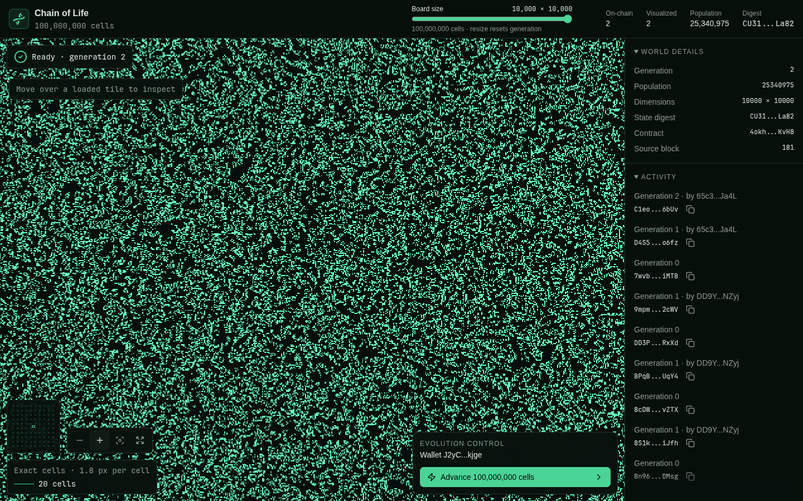

# Chain of Life

Conway's Game of Life on [Thruput](https://thruput.network/): up to **299 million
cells advanced atomically in one transaction**.

This developer experiment explores large on-chain workloads, with a browser
explorer to view the world and advance generations.



## How it works

The contract stores the complete grid. Clicking **Advance** submits one
transaction that computes and stores the next generation. The update is atomic:
if it fails, the world remains unchanged. If two visitors advance in the same
block, one commits. The node drops the other without effect, and that visitor
can advance again.

A Rust indexer reads the world from the contract, verifies its population and
digest (a hash of the world state), and serves tiles for the browser to display.
The browser keeps the previous world visible until the new tiles are ready.

The board ranges from 100 × 100 to 17,300 × 17,300 cells. Edges wrap around.
Resizing starts a new world at generation zero using the same seed.
Each browser creates a locally funded wallet, shared across reloads and tabs.

## Run locally

### Requirements

- Linux x86-64, Git, a current Node.js LTS release, and npm.
- Rust installed through [rustup](https://rustup.rs/).
  The repository configures the Rust toolchain needed to build the contracts.
- A C/C++ build toolchain, CMake, pkg-config, OpenSSL development headers, and
  `flock`; the local runtime also needs jemalloc and Snappy.
- A current Chromium browser with WebGL2, Web Crypto, and Web Locks enabled.

On Ubuntu, the native dependencies are:

```sh
sudo apt-get install build-essential cmake pkg-config libssl-dev util-linux libjemalloc2 libsnappy1v5
```

Install the Thruput CLI:

```sh
cargo install --version 0.45.2 --locked thruput
```

This demo uses **Thruput CLI 0.45.2**, which builds v6 contract artifacts.
`thruput node` manages its compatible runtime (hog-devnode 0.1.34)
automatically. Set `THRUPUT_CLI` to select another executable.

### Start the demo

```sh
git clone https://github.com/chambaz/chainoflife.git
cd chainoflife
thruput node \
  --data-dir data \
  --block-driver interval \
  --block-interval-ms 1000
```

Keep the node running. In another terminal, from the repository root:

```sh
npm ci
npm run deploy -- --preset local
npm run dev
```

Deployment creates and funds an account through the local faucet, then deploys
and verifies a full-size world at generation zero. `npm run dev` builds
and starts the indexer and browser app. The first build can take several minutes.

Open **http://127.0.0.1:5173** and wait for **Ready**. Click **Advance** to run one
generation, or drag and release the board-size slider to resize the world.

### Node settings

A 10,000 × 10,000 update uses about 310 million gas, and a full 17,300 × 17,300
update about 932 million, within the default 1-billion transaction cap. Gas
measures computation, not a token fee.

A local node allows 16 MiB of state output per transaction, enough for worlds
up to 11,400 × 11,400. Larger worlds need a node built with a higher
`max_subtransaction_output_bytes`; see [benchmarks](docs/benchmarks.md).

`--data-dir data` preserves the ledger in the Git-ignored `data/` directory at the
repository root. The block flags produce blocks once per second.

### Restart or recover

Stop each terminal with Ctrl-C. To resume the same world, repeat the `thruput node`
command above and run `npm run dev`; deployment is only needed once.

If deployment is interrupted, keep the same node data and run:

```sh
npm run deploy -- --preset local --resume
```

For custom ports, data directories, or a fresh world, see
[local configuration and recovery](docs/development.md).

## Run against Futurenet

```sh
npm run deploy -- --preset futurenet
npm run dev -- --config .env.futurenet
```

This deploys a fixed **17,300 × 17,300** world. The contract rejects size changes,
and the app hides the size control. The indexer and app run on your machine.

Each advance of this world writes 37.4 MB of state in one transaction. The
network must allow that much transaction output: its
`max_subtransaction_output_bytes` setting must be above the 16 MiB default;
64 MiB leaves room.

For custom sizes, build configuration, and recovery, see the
[deployment guide](docs/development.md#deployment).

## Code

| Directory | Purpose |
| --- | --- |
| [web](web) | Explorer and browser wallet |
| [contract](contract) | Atomic world contract and storage layout |
| [core](core) | Simulation, initialization, and digest |
| [indexer](indexer) | Verified snapshots and tile HTTP service |
| [scripts](scripts) | Deployment, development, build, and benchmarks |
| [tests](tests) | Browser and live checks |

See [architecture](docs/architecture.md), [development](docs/development.md),
and [benchmarks](docs/benchmarks.md). Run npm commands from the repository root.

## License

[Apache-2.0](LICENSE).
