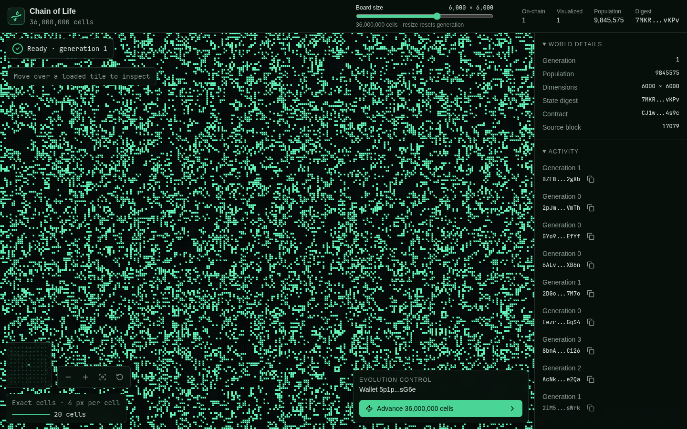

# Chain of Life

Conway's Game of Life on [Thruput](https://thruput.network/): up to **100 million
cells advanced atomically in one transaction**.

This is a developer experiment. It runs on a local node with a raised gas limit
to explore a large, single-transaction workload. It is not a hosted service or
a benchmark of public-network throughput.



## What happens on-chain?

The contract stores the complete grid. A visitor requests a tick, then the app
automatically submits a second transaction to process it. That transaction reads
the current generation and writes the next one atomically. If it fails, the world
and queued request remain unchanged.

```text
Browser wallet ── request + process transactions ──> Thruput contract
                                                        │
                                                  world + digest
                                                        ▼
Browser explorer <── immutable tiles ── Rust indexer verifies the full world
```

- Resize from 100 × 100 to 10,000 × 10,000 cells, in steps of 100.
- Edges wrap around: the board is a torus.
- Resizing resets generation to zero with the same deterministic seed. An
  internal reset counter distinguishes snapshots from different resets.
- The indexer verifies population and the on-chain digest before publishing.
  Browser tiles do not carry independent cryptographic proofs.
- The browser keeps the previous verified board visible until new tiles are ready.
  Transaction confirmation and visible rendering are separate stages.

## Run locally

### Requirements

- Linux x86-64, Git, Node.js **22.12+**, and npm.
- Rust 1.96+ installed through [rustup](https://rustup.rs/) for CLI installation.
  The repository pins
  `nightly-2026-07-01`, the RV32 target, and `rust-src`.
- A C/C++ build toolchain, CMake, pkg-config, OpenSSL development headers, and
  `flock`; the local runtime also needs jemalloc and Snappy.
- A current Chromium browser with WebGL2, Web Crypto, and Web Locks enabled.

On Ubuntu, the native dependencies are:

```sh
sudo apt-get install build-essential cmake pkg-config libssl-dev util-linux libjemalloc2 libsnappy1v5
```

Install the pinned CLI and its managed runtime:

```sh
cargo install thruput --version 0.43.0 --locked
thruput --version
thruput toolchain install 0.1.31
thruput toolchain use 0.1.31
thruput toolchain which
```

The `use` command selects the runtime globally. CLI **0.43.0** and
**hog-devnode 0.1.31** are the tested pair; do not override the
runtime protocol to force a different version. See the
[CLI installation guide](https://thruput.network/docs/cli/install/).
If another CLI is on your PATH, use the full path for `thruput node` and set
`THRUPUT_CLI=/path/to/thruput` in the setup terminal.

### Start the demo

```sh
git clone https://github.com/chambaz/chainoflife.git
cd chainoflife
thruput node \
  --port 9547 \
  --data-dir tmp/chain-of-life/atomic-node \
  --network-config max_tx_gas=60000000000 \
  --block-driver interval \
  --block-interval-ms 1000
```

Keep the node running. In another terminal, from the repository root:

```sh
cd apps/game-of-life
npm ci
npm run setup:local
npm run dev
```

Open **http://127.0.0.1:5173**. Setup creates its own accounts, requests funding
from the local node's faucet, then deploys and verifies a full-size world;
`dev` builds the Rust indexer and starts it with Vite. First-time Rust compilation
can take several minutes. Wait for the services-ready message and the board's
**Ready** indicator before interacting.
On the [reference machine](docs/validation.md), setup took about a minute with
cached contract compilation, and the first indexer release build took 71 seconds.

Use **Advance** to request and process one generation. Drag the board-size slider
and release it to reset. Each browser creates its own locally funded wallet;
reloads and tabs share it. Activity hashes can be copied in full.

`--network-config max_tx_gas=60000000000` raises the per-transaction cap to
**60 billion gas**. A full-world tick uses about 9.6 billion gas, above the default
1-billion cap; deployment and initialization also use a larger budget.
Gas is a computation budget, not a token fee. Repeat the same override when
restarting the saved ledger. The other flags select the app's RPC port, preserve
chain state, and produce blocks once per second.

Setup reads the faucet's public address from the runtime manifest under the
documented data directory. If you use another `--data-dir`, set
`THRUPUT_RUNTIME_MANIFEST` to its `runtime/runtime-manifest.json` before setup.
No account-allocation file or manually funded setup wallet is needed.

### Restart or recover

Stop each terminal with Ctrl-C. To resume the same world, repeat the `thruput node`
command above and run `npm run dev`; setup is only needed for the first deployment.

For interrupted setup, keep the same node data and run:

```sh
npm run setup:local -- --resume
```

Setup saves funding requests before calling the faucet. Resume observes saved
hashes, or recovers a missing faucet response with the same request nonce and
amount. It does not create a second funding request for the same attempt.

An interrupted unsigned browser reset becomes retryable. A signed reset is
observed by its original hash; it is not automatically resubmitted.
For a fresh ledger, different ports, or a setup transaction that cannot complete,
see [local configuration and recovery](apps/game-of-life/README.md).

## Code and checks

| Directory | Purpose |
| --- | --- |
| [contracts/game-of-life](contracts/game-of-life/README.md) | Atomic world contract and storage layout |
| `helpers/game-of-life-core` | Shared simulation, deterministic initialization, and digest |
| [helpers/game-of-life-indexer](helpers/game-of-life-indexer/README.md) | Verified snapshots, SQLite state, and tile HTTP service |
| [apps/game-of-life](apps/game-of-life/README.md) | Explorer, browser wallet, local setup, and tests |
| `apps/game-of-life-renderer-fixture` | Isolated renderer checks |
| `sim-fixtures/life-storage-admission` | Storage-funding workload fixture |

[AGENTS.md](AGENTS.md) lists code conventions and verification commands.
[Validation notes](docs/validation.md) record the tested environment, live checks,
and remaining dependency advisories. Those results are not public-network
performance claims.

## License

[Apache-2.0](LICENSE).
